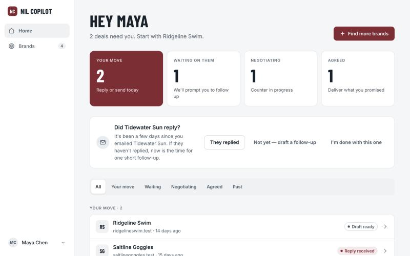
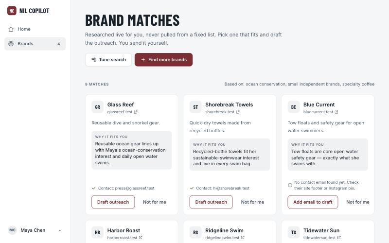
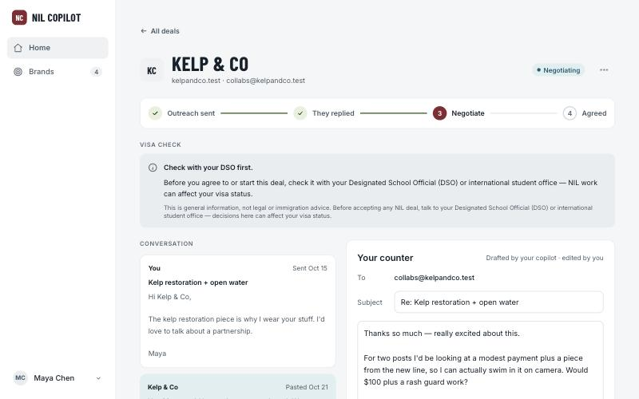
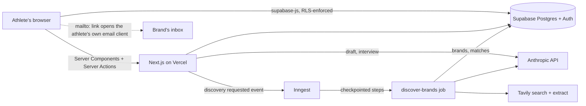

# NIL Copilot

[](https://github.com/jalietti/nil-copilot/actions/workflows/ci.yml)

**An AI copilot that helps student-athletes find and negotiate NIL brand deals
that actually fit them, without an agent.**

NIL marketplaces show every athlete the same handful of generic brands, and
traditional agents aren't interested in small deals for non-revenue-sport or
low-follower athletes. NIL Copilot researches real brands that match what an
athlete actually cares about, drafts the outreach in their voice, and helps
them negotiate. The athlete stays the sender of every email.

Built solo, end to end, and running a friends-and-family pilot at
[nil-copilot.vercel.app](https://nil-copilot.vercel.app) (invite-only).

| Home: who has the next move | Brand matches, researched live |
| --- | --- |
|  |  |



<sub>Screenshots use the local seed data: a fictional athlete and fictional brands.</sub>

## How it works

1. **Onboarding:** invite-gated sign-up, then a citizenship/visa step. International
   athletes get real guidance on NIL income and visas, up front.
2. **Interview:** a short questionnaire about interests, brands already used,
   values and deal preferences. Claude turns it into search tags and a voice profile.
3. **Discovery:** a background job searches the web for brands that fit, reads
   their pages, has Claude judge the fit, and finds a working contact email.
4. **Outreach:** Claude drafts the email; the athlete edits it and sends it from
   their own email client through a `mailto:` link.
5. **Negotiation:** the athlete pastes the brand's reply, and the copilot drafts a
   counter based on what the athlete said matters to them.

## Architecture



## Engineering highlights

- **The athlete always sends.** Outreach goes out through a `mailto:` handoff, never
  through an API: no Gmail OAuth, no SMTP, no inbox access. This is a deliberate
  legal-positioning decision about athlete-agent laws, not a shortcut
  ([ADR 1](docs/adr/0001-athlete-sends-outreach-via-mailto.md)).
- **Row-level security is the security boundary.** The browser reads Postgres
  directly, so every table holding athlete data has RLS policies and
  least-privilege grants. Cross-athlete isolation is tested twice: in-process
  against every migration with PGlite, and through real Supabase Auth JWTs and
  PostgREST ([ADR 2](docs/adr/0002-supabase-as-the-single-backend.md)).
- **Discovery is a durable background job.** A run takes minutes, so it runs on
  Inngest with every external call in its own checkpointed step. Retries resume
  instead of restarting, and a partial unique index allows only one run per
  athlete at a time ([ADR 3](docs/adr/0003-brand-discovery-is-a-background-job-over-a-growing-cache.md)).
- **No hardcoded brand list.** Brands come from live research and build up in a
  shared cache, so the product gets cheaper and faster as more athletes use it.
- **Privacy-preserving learning.** Brand responsiveness is recorded by database
  triggers as brand-level facts only (no athlete, no message text), readable
  only by the server, and may only reorder matches, never add off-interest ones
  ([ADR 4](docs/adr/0004-brand-outcomes-may-only-reorder-matches.md)).
- **Cost controls.** Every Anthropic and Tavily call is recorded per athlete,
  with daily caps enforced on the server.
- **Measured AI quality.** `npm run eval:discovery` runs the real discovery
  pipeline against sample athlete profiles and reports matches per tag and
  contact-email hit rate, before and after any change.

## Tech stack

| Area | Choice |
| --- | --- |
| App | Next.js 16 (App Router), React 19, TypeScript, Tailwind CSS 4 |
| Data and auth | Supabase: Postgres, Auth, row-level security |
| AI | Anthropic API (Claude) for interview normalization, fit evaluation and drafting |
| Web research | Tavily search and extract |
| Background jobs | Inngest |
| Hosting | Vercel |
| Observability | Sentry (errors), PostHog (pilot funnel) |
| Testing | Vitest, PGlite, Playwright |

Why these, what was cut and what's deferred: [`docs/tech-stack.md`](docs/tech-stack.md).

## Testing

320 unit and database tests, plus API-level RLS tests and Playwright end-to-end
tests. CI runs all of them, along with lint and a production build, on every push
and pull request.

| Command | What it proves |
| --- | --- |
| `npm test` | Unit logic, plus every migration's grants and RLS, run in-process on PGlite |
| `npm run test:rls` | Athlete A can't read or write athlete B's data through the real Supabase stack |
| `npm run test:e2e` | The core flow in Chromium: sign-up, onboarding, draft, send, paste reply, counter |
| `npm run eval:discovery` | Discovery quality against sample profiles (live, run by hand) |

Details: [`docs/testing.md`](docs/testing.md).

## Running it locally

Needs Node 24 and Docker.

```bash
npm install
cp .env.example .env.local   # add ANTHROPIC_API_KEY / TAVILY_API_KEY to draft or run discovery
npm run dev:local            # starts local Supabase in Docker, then the app on :3000
```

Log in as the seeded athlete `maya@example.test` / `nilcopilot-local`. The seed
covers every screen state, so you can explore without spending API credits.

## Project docs

- [`CONTEXT.md`](CONTEXT.md): domain glossary
- [`docs/adr/`](docs/adr/): architecture decision records
- [`docs/problem-framing-canvas.md`](docs/problem-framing-canvas.md) and
  [`docs/storyboard.md`](docs/storyboard.md): the problem and the user journey,
  written before any code
- [`docs/`](docs/): everything else

## Built with AI coding tools

I built this with Claude Code, and the repo shows how I keep an AI collaborator on
the rails rather than letting it improvise:

- [`CLAUDE.md`](CLAUDE.md) lists the hard product constraints (mailto-only
  outreach, no extra vendors, no curated brand list) so they're never re-argued.
- [`.claude/skills/supabase-migration`](.claude/skills/supabase-migration/SKILL.md)
  is a checklist every schema change follows: write the migration, add isolation
  tests, regenerate types, then promote local → dev → prod.
- [`.claude/agents/ui-screen-builder.md`](.claude/agents/ui-screen-builder.md)
  is a scoped agent that may only restyle UI code and must pass typecheck, lint and tests.
- Feature work happens on branches and merges through pull requests gated by CI.

## License

All rights reserved. The source is public to read, but it isn't licensed for reuse.
